# KubeLab - Kubernetes on Proxmox with GitOps

Final group project for the Virtualization course (group 6). A physical machine runs Proxmox VE, Proxmox runs 4 VMs with k3s, and the cluster runs the platform (MetalLB, Traefik, NFS storage, metrics-server, Doppler Operator), the applications (API, web and PostgreSQL) and the observability stack (Prometheus, Loki, Promtail, Grafana). Everything after the cluster bootstrap is deployed by Argo CD from this monorepo.

| Item | Value |
|---|---|
| Group | 6 |
| Domain | `grupo6.lab` |
| Traefik LoadBalancer IP | `10.60.129.240` |
| Network | Group hotspot, SSID `kubelab-grupo6`, subnet `10.60.129.0/24` |
| Repository | `https://github.com/alejandrocald13/virtualization-project` (private, teacher added as collaborator), branch `main` |
| Teacher guide | [docs/access.md](docs/access.md) and [docs/hosts.txt](docs/hosts.txt) |
| AI usage | [docs/ia.md](docs/ia.md) |

## Contents

1. [Architecture](#1-architecture)
2. [Environment and Versions](#2-environment-and-versions)
3. [Node Inventory and Network](#3-node-inventory-and-network)
4. [Repository Structure](#4-repository-structure)
5. [Rebuild from Scratch](#5-rebuild-from-scratch)
6. [Platform](#6-platform)
7. [Applications](#7-applications)
8. [CI/CD and GitOps](#8-cicd-and-gitops)
9. [Secrets with Doppler](#9-secrets-with-doppler)
10. [Observability](#10-observability)
11. [High Availability, Scaling and Persistence](#11-high-availability-scaling-and-persistence)
12. [URL Table](#12-url-table)
13. [Teacher Access](#13-teacher-access)
14. [Design Decisions and Known Limitations](#14-design-decisions-and-known-limitations)
15. [Evidence](#15-evidence)

## 1. Architecture

### 1.1 Network and Cluster

```
 Teacher / team laptop   (hosts file: *.grupo6.lab -> 10.60.129.240)
        |
        |  WiFi "kubelab-grupo6"  10.60.129.0/24  (gateway = phone 10.60.129.208)
        v
 +-------------------------------------------------------------------------+
 | Proxmox VE 9.2  (pve.kubelab.lan)                                       |
 |   wlo1  10.60.129.229 (DHCP)                                            |
 |     - proxy ARP: answers ARP for 10.60.129.240-243 with its own MAC     |
 |     - route 10.60.129.240/30 -> vmbr0                                   |
 |     - MASQUERADE 10.10.10.0/24 -> wlo1 (internet for the VMs)           |
 |   NFS server  /srv/nfs/kubelab  (thin LV, 100 GB) -> 10.10.10.0/24      |
 |                                                                         |
 |   vmbr0  10.10.10.1/24  (internal bridge, no physical port, no DHCP)    |
 |     |               |                 |                 |               |
 |   VM 101          VM 111            VM 112            VM 113            |
 |   k3s-cp-01       k3s-worker-01     k3s-worker-02     k3s-worker-03     |
 |   10.10.10.11     10.10.10.21       10.10.10.22       10.10.10.23       |
 |   NoSchedule                                                            |
 +-------------------------------------------------------------------------+
        |
        v  MetalLB L2: a speaker on a worker announces 10.60.129.240 on vmbr0
 Traefik (Service LoadBalancer 10.60.129.240, 2 replicas)
   :80   IngressRoute by Host()            :5432 IngressRouteTCP
   |-- app.grupo6.lab        -> web:8080 (nginx) --/api/--> api:3000
   |-- api.grupo6.lab        -> api:3000 --> postgres:5432
   |-- grafana.grupo6.lab    -> grafana:80
   |-- prometheus.grupo6.lab -> prometheus-server:80
   |-- argocd.grupo6.lab     -> argocd-server:80
   '-- db.grupo6.lab:5432    -> postgres:5432
 PersistentVolumeClaims (StorageClass nfs-client) -> NFS on the Proxmox host
```

### 1.2 Delivery and Secrets

```
 Member --push / merge PR--> GitHub (main)
                               |  changes in apps/api/** or apps/web/**
                               v
                     GitHub Actions (api.yml / web.yml)
                       1. Doppler config "dev" -> test credentials and Docker Hub token
                       2. tests (the API runs them against a real PostgreSQL)
                       3. build and push docker.io/alejandrocald13/kubelab-<app>:<short-sha>
                       4. kustomize edit set image + commit "ci(<app>): deploy image <short-sha>"
                               |
                               v
 Argo CD (in the cluster) --reads main every 60 s--> root (app of apps) -> 18 Applications
        ^                                             automated sync, prune, selfHeal
        | repository credential (Secret kubelab-repo)
 Doppler Operator <-- Doppler config "prd" (service token: the only manual Secret)
        |
        '--> Kubernetes Secrets: postgres-credentials, api-credentials, grafana-credentials
```

## 2. Environment and Versions

| Component | Version / value |
|---|---|
| Physical host | Laptop, Intel Core i5-11400H (12 threads, VT-x), 24 GB RAM, 1 TB NVMe for Proxmox |
| Hypervisor | Proxmox VE 9.2 (`pve-manager` 9.2.25, kernel 7.0.14), repository `pve-no-subscription` |
| VM image | Ubuntu 24.04 cloud image `release-20261017` (SHA256 checked) |
| Kubernetes | k3s `v1.36.5+k3s1` (bundled Traefik, ServiceLB, local-storage and metrics-server disabled) |
| Argo CD | v3.5.6 (`install.yaml` pinned, installed with Kustomize) |
| MetalLB | chart `metallb/metallb` 0.16.1, L2 mode |
| Traefik | chart `traefik/traefik` 41.7.1 (Traefik v3.7.14) and `traefik/traefik-crds` 1.18.0 |
| NFS provisioner | chart `nfs-subdir-external-provisioner` 4.0.18 |
| metrics-server | chart 3.14.0 |
| Doppler Operator | chart `doppler-kubernetes-operator` 1.7.5 |
| Prometheus | chart `prometheus-community/prometheus` 29.37.0 (with kube-state-metrics and node-exporter) |
| Loki | chart `grafana-community/loki` 18.15.1 (monolithic) |
| Promtail | chart `grafana/promtail` 6.17.1 (image 3.6.11) |
| Grafana | chart `grafana-community/grafana` 13.7.0 |
| Database | `postgres:17.11-alpine` |
| API | Node.js 24, Express 5.3.0, pg 8.23.1, prom-client 15.1.3 |
| Web | React 19.3.1, Vite 8.3.5, served by `nginx-unprivileged:1.30.6-alpine` |
| Package manager | pnpm 12.16.1 |
| Registry | Docker Hub, public repositories `alejandrocald13/kubelab-api` and `alejandrocald13/kubelab-web` |
| Load test | k6 1.8.2 (`grafana/k6:1.8.2`) |

## 3. Node Inventory and Network

### 3.1 Nodes

| VM ID | Name | IP | vCPU | RAM | Disk | Role |
|---|---|---|---|---|---|---|
| 9000 | `ubuntu-2404-template` | - | 2 | 2048 MB | 3.5 GB | cloud-init template |
| 101 | `k3s-cp-01` | `10.10.10.11` | 2 | 4096 MB | 25 GB | control plane (taint `NoSchedule`) |
| 111 | `k3s-worker-01` | `10.10.10.21` | 3 | 4096 MB | 40 GB | worker |
| 112 | `k3s-worker-02` | `10.10.10.22` | 3 | 4096 MB | 40 GB | worker |
| 113 | `k3s-worker-03` | `10.10.10.23` | 3 | 4096 MB | 40 GB | worker |

All VMs: CPU type `host`, VirtIO network on `vmbr0`, QEMU guest agent, `onboot: 1`, balloon equal to memory (the guest reports its memory to Proxmox, but Proxmox never takes RAM away).

### 3.2 Network

| Item | Value |
|---|---|
| Hotspot | Android phone, SSID `kubelab-grupo6` (WPA2), subnet `10.60.129.0/24`, gateway `10.60.129.208` |
| Proxmox host | `wlo1`, `10.60.129.229` by DHCP from the hotspot |
| Cluster network | `10.10.10.0/24` on `vmbr0` (internal bridge, static IPs by cloud-init) |
| VM gateway | `10.10.10.1` (Proxmox host, MASQUERADE to the WiFi) |
| VM DNS | `1.1.1.1 8.8.8.8` |
| **MetalLB pool (INF-06)** | `10.60.129.240-10.60.129.243`, `autoAssign: false`, reserved inside the hotspot subnet and answered by the host with proxy ARP |
| Traefik | `10.60.129.240` |
| NFS server | `10.10.10.1:/srv/nfs/kubelab` |

**Why a routed network with proxy ARP.** A WiFi interface in client mode cannot be part of a Linux bridge: the access point drops frames whose source MAC is not the associated client. So the VMs live on an internal bridge and the host routes. For the MetalLB IPs, the host answers ARP on the WiFi with its own MAC (proxy ARP) and routes the `/30` to `vmbr0`, where MetalLB announces the IP. For any laptop on the hotspot, `10.60.129.240` is just another address on its own network: no routes are needed.

## 4. Repository Structure

```
.
├── README.md
├── apps/
│   ├── api/                  Node.js API: src/, test/, Dockerfile, package.json, pnpm-lock.yaml
│   └── web/                  React web: src/, test/, nginx.conf, Dockerfile, package.json, pnpm-lock.yaml
├── infra/
│   ├── proxmox/              interfaces.example, nfs-exports, authorized_keys, create-template.sh,
│   │                         create-vms.sh, cloud-init/kubelab-vendor.yaml
│   └── k3s/                  server-config.yaml, agent-config.yaml, install-server.sh, install-agent.sh
├── k8s/
│   ├── argocd/
│   │   ├── install/          Argo CD v3.5.6 (install.yaml + Kustomize patches)
│   │   ├── routes/           IngressRoute argocd.grupo6.lab
│   │   ├── root.yaml         app of apps
│   │   └── apps/             one Application per component (18)
│   ├── platform/             namespaces, MetalLB (+ pool), Traefik, NFS provisioner, metrics-server,
│   │                         DopplerSecrets
│   ├── apps/                 api, web and database (StatefulSet, migrations, IngressRouteTCP)
│   └── observability/        Prometheus, Loki, Promtail, Grafana (dashboard, viewer user) and routes
├── loadtest/api-load.js      k6 load test for the HPA
├── .github/workflows/        api.yml, web.yml
└── docs/                     access.md, hosts.txt, ia.md, screenshots
```

The layout follows the structure requested by the assignment. VM creation and cluster installation are documented in section 5 of this README; the zone file is [docs/hosts.txt](docs/hosts.txt).

## 5. Rebuild from Scratch

Ordered steps. Everything after step 5.10 is applied by Argo CD from this repository.

| Step | Action | Where |
|---|---|---|
| 5.1 | Hotspot | Phone |
| 5.2 | Install Proxmox VE and prepare the host | Host console |
| 5.3 | Routed network with proxy ARP | Host console |
| 5.4 | Team SSH access | Host |
| 5.5 | NFS server | Host |
| 5.6 | Cloud-init template | Host |
| 5.7 | Create the 4 VMs | Host |
| 5.8 | Install k3s | VMs |
| 5.9 | `kubectl` from a laptop | Laptop |
| 5.10 | Doppler, GitHub and Argo CD bootstrap | Doppler, GitHub, laptop |
| 5.11 | Argo CD read-only account | Laptop |

### 5.1 Hotspot

| Setting | Value |
|---|---|
| SSID | `kubelab-grupo6` |
| Security | WPA2 (password delivered in person) |
| Auto turn-off | Disabled; phone charging |

Check the subnet from a laptop (`ipconfig` / `ip addr`) and restart the hotspot once to confirm it keeps the same subnet. The MetalLB pool and [docs/hosts.txt](docs/hosts.txt) depend on it.

### 5.2 Proxmox VE Installation

| Installer setting | Value |
|---|---|
| Target disk | NVMe, ext4 (LVM-thin `local-lvm`; ZFS not used to keep its RAM cache out of the way) |
| Country / time zone | Guatemala / `America/Guatemala` |
| Hostname | `pve.kubelab.lan` |
| Management network | Ethernet NIC with a temporary static IP; replaced by the WiFi in 5.3 |

BIOS: Intel VT-x enabled. Secure Boot disabled (after `full-upgrade`, the new kernel failed with `Verification failed 0x1A`).

After the first boot, on the web UI (`pve` > Updates > Repositories) disable both `enterprise` repositories and add `No-Subscription`. Then, as root:

```bash
apt update && apt full-upgrade -y
apt install -y sudo wpasupplicant iw nfs-kernel-server
```

The WiFi packages are installed while the Ethernet cable is still connected: without them the host has no internet on the hotspot.

The host is a laptop, so closing the lid must not suspend it:

```bash
mkdir -p /etc/systemd/logind.conf.d
printf '[Login]\nHandleLidSwitch=ignore\nHandleLidSwitchExternalPower=ignore\nHandleLidSwitchDocked=ignore\n' \
  > /etc/systemd/logind.conf.d/lid.conf
```

### 5.3 Routed Network with Proxy ARP

Reference file: [infra/proxmox/interfaces.example](infra/proxmox/interfaces.example) (`/etc/network/interfaces`):

```
auto wlo1
iface wlo1 inet dhcp
    wpa-ssid kubelab-grupo6
    wpa-psk <HOTSPOT_PSK_HEX>
    post-up sysctl -w net.ipv4.conf.wlo1.proxy_arp=1
    post-up iw dev wlo1 set power_save off

auto vmbr0
iface vmbr0 inet static
    address 10.10.10.1/24
    bridge-ports none
    bridge-stp off
    bridge-fd 0
    post-up   ip route replace 10.60.129.240/30 dev vmbr0
    post-up   echo 1 > /proc/sys/net/ipv4/ip_forward
    post-up   iptables -t nat -A POSTROUTING -s 10.10.10.0/24 -o wlo1 -j MASQUERADE
    post-down iptables -t nat -D POSTROUTING -s 10.10.10.0/24 -o wlo1 -j MASQUERADE
```

The WiFi password never reaches the repository. On the host, as root, it is typed without echo and only its hex form is written to the file:

```bash
read -rs -p "Hotspot password: " HOTSPOT_PASS; echo
PSK_HEX=$(wpa_passphrase kubelab-grupo6 "$HOTSPOT_PASS" | sed -n 's/^[[:space:]]*psk=\([0-9a-f]\{64\}\)$/\1/p')
unset HOTSPOT_PASS
sed "s/<HOTSPOT_PSK_HEX>/$PSK_HEX/" interfaces.example > /etc/network/interfaces
unset PSK_HEX
chmod 600 /etc/network/interfaces
```

Apply from the physical console and **reboot** (`ifreload` leaves the previous default route behind when switching uplinks). Then update `/etc/hosts` with the new address (`<IP> pve.kubelab.lan pve`) and check:

```bash
ip -br addr show wlo1
ip route                                  # default via the phone, 10.60.129.240/30 dev vmbr0
cat /proc/sys/net/ipv4/conf/wlo1/proxy_arp   # 1
iptables -t nat -S POSTROUTING            # MASQUERADE -o wlo1
ping -c 3 1.1.1.1
```

The Proxmox firewall stays disabled. Web UI: `https://10.60.129.229:8006`.

### 5.4 Team SSH Access

Each member uses a personal lab key (`~/.ssh/kubelab_ed25519`) and a personal Linux user on the host. The VMs are reached through the host with `ProxyJump`; no laptop needs a route to `10.10.10.0/24`.

On the host, as root:

```bash
adduser roberto
adduser luarca
echo 'roberto ALL=(ALL) NOPASSWD:ALL' > /etc/sudoers.d/kubelab-roberto && chmod 440 /etc/sudoers.d/kubelab-roberto
```

From each laptop: `ssh-copy-id -i ~/.ssh/kubelab_ed25519.pub <user>@10.60.129.229`. After every member logs in with the key, password logins are disabled:

```bash
printf "PasswordAuthentication no\nKbdInteractiveAuthentication no\nPermitRootLogin prohibit-password\n" \
  > /etc/ssh/sshd_config.d/kubelab.conf
sshd -t && systemctl reload ssh
```

`~/.ssh/config` on each laptop:

```
Host kubelab-pve
    HostName 10.60.129.229
    User <user>
    IdentityFile ~/.ssh/kubelab_ed25519

Host kubelab-cp
    HostName 10.10.10.11
    User ubuntu
    ProxyJump kubelab-pve
    IdentityFile ~/.ssh/kubelab_ed25519

# kubelab-worker-01/02/03: same block with 10.10.10.21, .22 and .23
```

The public keys that cloud-init puts in the VMs are in [infra/proxmox/authorized_keys](infra/proxmox/authorized_keys). Private keys never leave each laptop.

### 5.5 NFS Server on the Host

```bash
lvcreate -V 100G -T pve/data -n nfs-kubelab
mkfs.ext4 /dev/pve/nfs-kubelab
mkdir -p /srv/nfs/kubelab
echo "/dev/pve/nfs-kubelab /srv/nfs/kubelab ext4 defaults,nofail 0 2" >> /etc/fstab
systemctl daemon-reload && mount -a
mkdir -p /etc/exports.d
cp infra/proxmox/nfs-exports /etc/exports.d/kubelab.exports
exportfs -ra && exportfs -v
```

[infra/proxmox/nfs-exports](infra/proxmox/nfs-exports): `/srv/nfs/kubelab 10.10.10.0/24(rw,sync,no_subtree_check,no_root_squash)`. `nofail` keeps the host booting if the volume fails; `no_root_squash` lets containers such as PostgreSQL change the owner of their data folder. Only the internal network can mount it.

### 5.6 Cloud-init Template

Copy `infra/` to the host (`scp -r infra kubelab-pve:/tmp/` and, as root, `cp -r /tmp/infra /root/kubelab/`), then:

```bash
pvesm set local --content iso,vztmpl,backup,import,snippets
mkdir -p /var/lib/vz/snippets
cp /root/kubelab/infra/proxmox/cloud-init/kubelab-vendor.yaml /var/lib/vz/snippets/
bash /root/kubelab/infra/proxmox/create-template.sh
```

[create-template.sh](infra/proxmox/create-template.sh) downloads the Ubuntu 24.04 cloud image, checks its SHA256 and creates template `9000` (VirtIO SCSI disk imported from the image, cloud-init drive, user `ubuntu`, SSH keys from `authorized_keys`, DNS `1.1.1.1 8.8.8.8`, QEMU agent, serial console).

The vendor snippet [kubelab-vendor.yaml](infra/proxmox/cloud-init/kubelab-vendor.yaml) sets the time zone, installs `qemu-guest-agent` and `nfs-common`, and masks services a cluster node does not need (`fwupd`, `multipathd`, `ModemManager`, `udisks2`, `unattended-upgrades`, `apt-daily`), so no automatic upgrade runs during a demo.

### 5.7 Create the VMs (INF-03)

```bash
bash /root/kubelab/infra/proxmox/create-vms.sh
qm list
```

[create-vms.sh](infra/proxmox/create-vms.sh) does, for each node of section 3.1:

1. `qm clone 9000 <id> --name <name> --full`: full clone of the template.
2. `qm set <id> --cores <n> --memory 4096 --balloon 4096 --onboot 1 --ipconfig0 ip=<ip>/24,gw=10.10.10.1`: CPU, RAM, start with the host and fixed IP through cloud-init.
3. `qm resize <id> scsi0 <size>`: 25 GB for the control plane, 40 GB for the workers.
4. `qm start <id>`.

Check each VM (expected `status: done`):

```bash
ssh kubelab-cp 'hostname; ip -4 -br addr; cloud-init status; systemctl is-active qemu-guest-agent'
```

### 5.8 Install k3s (INF-04)

**Why k3s.** CNCF-certified Kubernetes in a single binary, with SQLite as the default datastore, low memory use on the control plane and one-command installation for server and agents. Its bundled Traefik, ServiceLB, local-path storage and metrics-server are disabled, so our own versions are installed by Argo CD with values from this repository. kubeadm would add etcd and more components to operate without changing what the assignment evaluates; RKE2 is heavier for 4 VMs on one host.

Control plane ([server-config.yaml](infra/k3s/server-config.yaml): `node-ip`, `tls-san`, disabled components and the taint `node-role.kubernetes.io/control-plane=true:NoSchedule`):

```bash
scp infra/k3s/server-config.yaml infra/k3s/install-server.sh kubelab-cp:
ssh kubelab-cp 'bash install-server.sh && sudo k3s kubectl get nodes'
```

Workers ([agent-config.yaml](infra/k3s/agent-config.yaml) reserves 200 MiB for the OS). The join token goes through standard input, never through the screen or the shell history:

```bash
K3S_TOKEN=$(ssh kubelab-cp 'sudo cat /var/lib/rancher/k3s/server/node-token')
for h in kubelab-worker-01 kubelab-worker-02 kubelab-worker-03; do
  scp infra/k3s/agent-config.yaml infra/k3s/install-agent.sh $h:
  ssh $h 'read -r K3S_TOKEN; export K3S_TOKEN; bash install-agent.sh' <<< "$K3S_TOKEN"
done
unset K3S_TOKEN
```

```bash
kubectl get nodes -o wide
kubectl describe node k3s-cp-01 | grep Taints
```

Expected: 4 nodes `Ready` on `v1.36.5+k3s1` and the taint on `k3s-cp-01` (INF-05).

### 5.9 kubectl from a Laptop

The kubeconfig is an admin credential: it is never committed (`*.kubeconfig` is in `.gitignore`). It is used through an SSH tunnel, so it keeps `server: https://127.0.0.1:6443`.

```bash
ssh kubelab-cp 'cat /etc/rancher/k3s/k3s.yaml' > ~/.kube/kubelab.kubeconfig && chmod 600 ~/.kube/kubelab.kubeconfig
ssh -f -N -L 6443:10.10.10.11:6443 kubelab-pve
export KUBECONFIG=~/.kube/kubelab.kubeconfig
kubectl get nodes
```

### 5.10 Doppler, GitHub and Argo CD Bootstrap

1. **Doppler** (section 9): project `virtualization-project` with configs `prd` (cluster) and `dev` (CI).
2. **GitHub**: repository secret `DOPPLER_TOKEN` (read-only service token of `dev`); Settings > Actions > General > Workflow permissions: **Read and write**.
3. **IP pool**: [ipaddresspool.yaml](k8s/platform/metallb-config/ipaddresspool.yaml) and [traefik/values.yaml](k8s/platform/traefik/values.yaml) must use the hotspot subnet.
4. **Bootstrap**, the only manual `kubectl` commands of the project. The repository is private, so Argo CD needs its credential before it can read Git: the Doppler Operator comes from its public Helm chart, and the repository credential from a `DopplerSecret` applied from the local copy.

```bash
kubectl apply --server-side --force-conflicts -k k8s/argocd/install
kubectl apply -f k8s/argocd/apps/doppler-operator.yaml
kubectl wait --for=condition=Established crd/dopplersecrets.secrets.doppler.com --timeout=300s

read -rs DOPPLER_SERVICE_TOKEN        # read-only service token of the prd config
kubectl create secret generic doppler-token-secret -n doppler-operator-system \
  --from-literal=serviceToken="$DOPPLER_SERVICE_TOKEN"
unset DOPPLER_SERVICE_TOKEN

kubectl apply -f k8s/platform/doppler-secrets/argocd-repo.yaml
kubectl get secret kubelab-repo -n argocd --show-labels
kubectl apply -f k8s/argocd/root.yaml
```

5. Wait until every Application is `Synced` and `Healthy` (about 6 minutes):

```bash
kubectl get applications -n argocd
```

`root` then adopts the same Doppler Operator and `argocd-repo` resources, because they are in Git with the same names.

### 5.11 Argo CD Read-only Account

The account `docente` is declared in [argocd-cm.yaml](k8s/argocd/install/argocd-cm.yaml) (`accounts.docente: login`) and bound to `role:readonly` in [argocd-rbac-cm.yaml](k8s/argocd/install/argocd-rbac-cm.yaml). Its password comes from Doppler and is hashed inside the Argo CD server pod, so it is never printed:

```bash
ARGOCD_READONLY_PASSWORD=$(doppler secrets get ARGOCD_READONLY_PASSWORD --plain --project virtualization-project --config prd)
PASSWORD_HASH=$(kubectl -n argocd exec deploy/argocd-server -- argocd account bcrypt --password "$ARGOCD_READONLY_PASSWORD")
kubectl -n argocd patch secret argocd-secret --type merge \
  -p "{\"stringData\":{\"accounts.docente.password\":\"$PASSWORD_HASH\",\"accounts.docente.passwordMtime\":\"$(date -u +%Y-%m-%dT%H:%M:%SZ)\"}}"
unset ARGOCD_READONLY_PASSWORD PASSWORD_HASH
```

The admin password is in the Secret `argocd-initial-admin-secret` and is never shared.

## 6. Platform

| Component | Files | Configuration |
|---|---|---|
| Namespaces | [k8s/platform/namespaces](k8s/platform/namespaces) | `kubelab` and `monitoring`, created first so Doppler can write Secrets into them |
| MetalLB (NET-01) | [metallb/values.yaml](k8s/platform/metallb/values.yaml), [metallb-config](k8s/platform/metallb-config) | L2 mode, FRR disabled, speakers only on workers. `IPAddressPool kubelab-pool` `10.60.129.240-10.60.129.243` (`autoAssign: false`) and `L2Advertisement kubelab-l2` |
| Traefik (NET-02 to NET-04) | [traefik/values.yaml](k8s/platform/traefik/values.yaml) | 2 replicas, Service `LoadBalancer` with `metallb.io/loadBalancerIPs: 10.60.129.240`, entrypoints `web` (80) and `postgres` (5432), only the CRD provider (IngressRoute), access log on, HTTPS entrypoint not exposed |
| NFS provisioner (PER-01) | [nfs-provisioner/values.yaml](k8s/platform/nfs-provisioner/values.yaml) | Server `10.10.10.1:/srv/nfs/kubelab`, StorageClass `nfs-client` (**default**), `reclaimPolicy: Retain`, `archiveOnDelete: true`, folders `<namespace>-<pvc>` |
| metrics-server (HA-04) | [metrics-server/values.yaml](k8s/platform/metrics-server/values.yaml) | `--kubelet-insecure-tls` (k3s kubelet certificates are self-signed) |
| Doppler Operator (SEC-02) | [doppler-operator.yaml](k8s/argocd/apps/doppler-operator.yaml), [doppler-secrets](k8s/platform/doppler-secrets) | Public chart 1.7.5; 4 `DopplerSecret` resources (section 9) |

Database route ([ingressroutetcp.yaml](k8s/apps/database/ingressroutetcp.yaml)). PostgreSQL has no TLS SNI, so everything arriving at entrypoint `postgres` goes to this Service:

```yaml
apiVersion: traefik.io/v1alpha1
kind: IngressRouteTCP
metadata:
  name: postgres
  namespace: kubelab
spec:
  entryPoints:
    - postgres
  routes:
    - match: HostSNI(`*`)
      services:
        - name: postgres
          port: 5432
```

```bash
kubectl get ipaddresspool,l2advertisement -n metallb-system
kubectl get svc -n traefik traefik          # EXTERNAL-IP 10.60.129.240
kubectl get storageclass
```

## 7. Applications

Entity: `products` (inventory). Node.js 24, ESM, pnpm.

### 7.1 API (`apps/api`, APP-01)

| Method | Path | Description |
|---|---|---|
| GET | `/health` | Readiness: runs `SELECT 1`; 200, or 503 if the database does not answer |
| GET | `/health/live` | Liveness, without the database |
| GET | `/metrics` | Prometheus metrics: default Node.js metrics, `http_requests_total{method,route,status_code}` and `http_request_duration_seconds` (labelled by route pattern, not by id) |
| GET | `/api/products` | List products |
| POST | `/api/products` | Create (`name` required up to 120 chars, `quantity` integer >= 0, `price` >= 0); 400 with the list of errors |
| GET | `/api/products/:id` | Get one; 404 if it does not exist |
| PUT | `/api/products/:id` | Update; 404 if it does not exist |
| DELETE | `/api/products/:id` | Delete; 204, or 404 if it does not exist |

- One JSON log line per request to stdout (collected by Promtail); probes and `/metrics` are not logged.
- `DATABASE_URL` comes from the Secret `api-credentials` (Doppler).
- On `SIGTERM` it stops accepting connections, finishes in-flight requests and closes the database pool (clean rolling updates).
- Tests: `pnpm test` runs unit tests with an in-memory repository (CRUD, validation, health, metrics) and an integration test against PostgreSQL when `DATABASE_URL` is set (always in CI).

### 7.2 Web (`apps/web`, APP-02)

React (Vite) client that lists, creates, edits and deletes products through relative calls to `/api/products`. In the cluster, nginx serves the static build and proxies `/api/` to the internal Service `api.kubelab.svc.cluster.local:3000`, so the browser only talks to `app.grupo6.lab` (no CORS). Tests: `pnpm test` (Vitest, API client with a mocked `fetch`).

### 7.3 Database (`k8s/apps/database`, APP-03, APP-07, PER-03)

| Resource | Configuration |
|---|---|
| StatefulSet `postgres` | 1 replica, `postgres:17.11-alpine`, `serviceName: postgres-headless`, `envFrom` Secret `postgres-credentials`, `shared_buffers=64MB`, `max_connections=50` |
| Volume | `volumeClaimTemplates` `data`, 5Gi on `nfs-client` |
| Probes | readiness and liveness with `pg_isready` |
| Services | `postgres` (ClusterIP 5432) and `postgres-headless` |
| Job `db-init` | Argo CD `PostSync` hook: waits for PostgreSQL and runs the migrations |
| Migrations | [001_create_products.sql](k8s/apps/database/migrations/001_create_products.sql) (`CREATE TABLE IF NOT EXISTS products`) and [002_readonly_role.sql](k8s/apps/database/migrations/002_readonly_role.sql) (read-only role `docente`: `CONNECT`, `USAGE` and `SELECT` only), both idempotent |

### 7.4 API and Web Manifests (`k8s/apps/api`, `k8s/apps/web`, HA-01 to HA-03)

| Setting | api | web |
|---|---|---|
| Image | `docker.io/alejandrocald13/kubelab-api:<short-sha>` | `docker.io/alejandrocald13/kubelab-web:<short-sha>` |
| `replicas` field | Not set: the HPA owns it (otherwise selfHeal would reset it on every scale) | Not set |
| Strategy | `RollingUpdate`, `maxUnavailable: 0`, `maxSurge: 1` | Same |
| Spread | `topologySpreadConstraints` by node (`ScheduleAnyway`) | Same |
| Security | `runAsNonRoot`, `runAsUser: 1000` | `runAsNonRoot`, `runAsUser: 101` |
| Readiness / liveness | `GET /health` (3 s initial delay) / `GET /health/live` | `GET /healthz` / `GET /healthz` |
| Requests / limits | `100m`, `128Mi` / `500m`, `256Mi` | `50m`, `16Mi` / `250m`, `64Mi` |
| Other | Pod annotations `prometheus.io/scrape`, `port: "3000"`, `path: /metrics`; Deployment annotation `secrets.doppler.com/reload: "true"` | - |
| HPA / PDB | 2 to 6 replicas at 60 % CPU / `minAvailable: 1` | Same |
| IngressRoute | ``Host(`api.grupo6.lab`)`` | ``Host(`app.grupo6.lab`)`` |

## 8. CI/CD and GitOps

### 8.1 Flow

1. A member pushes to `main` (or merges a pull request) with changes in `apps/api/**` or `apps/web/**`.
2. Only the workflow of that application runs (path filter, CD-01). On pull requests only the tests run.
3. `test`: credentials from Doppler (`dopplerhq/secrets-fetch-action`, SEC-03). The API starts PostgreSQL 17 with `docker run` (not `services:`, because services start before the Doppler variables exist), applies the first migration and runs `pnpm test`; the web runs `pnpm test` and `pnpm build`.
4. `build-and-deploy`: login to Docker Hub with the token from Doppler, build and push `docker.io/alejandrocald13/kubelab-<app>:<short-sha>` (APP-05: never `latest`).
5. `kustomize edit set image` updates `newTag` in `k8s/apps/<app>/kustomization.yaml` and the bot commits `ci(<app>): deploy image <short-sha>` to `main`.
6. Argo CD detects the commit (reconciliation every 60 s) and syncs the Application: RollingUpdate without downtime.
7. A change only in `k8s/` runs no workflow: Argo CD applies it directly.

Details in [.github/workflows/api.yml](.github/workflows/api.yml) and [.github/workflows/web.yml](.github/workflows/web.yml):

- A push made with `GITHUB_TOKEN` does not trigger other workflows, so the bot commit does not create a loop.
- Both workflows share the `concurrency` group `deploy-manifests`, so they never push manifests at the same time; `git pull --rebase` covers commits made in between.

### 8.2 Argo CD (CD-02 to CD-04)

Installed from [k8s/argocd/install](k8s/argocd/install): pinned `install.yaml` v3.5.6 plus Kustomize patches. `server.insecure` (Traefik serves HTTP), `url: http://argocd.grupo6.lab`, `timeout.reconciliation: 60s`, account `docente` with `role:readonly`, and a health check for `Application` resources so each sync wave waits until the previous one is `Healthy`. Dex, notifications and the ApplicationSet controller are scaled to 0 because they are not used. Argo CD does not manage its own installation: changes to `k8s/argocd/install` are applied with the bootstrap command.

[root.yaml](k8s/argocd/root.yaml) (app of apps) points to [k8s/argocd/apps](k8s/argocd/apps). Every Application uses `automated` sync with `prune: true` and `selfHeal: true`, and `ServerSideApply=true`.

| Wave | Application | Source | Namespace |
|---|---|---|---|
| -10 | `namespaces` | `k8s/platform/namespaces` | - |
| -9 | `metallb` | chart 0.16.1 + values | `metallb-system` |
| -9 | `nfs-provisioner` | chart 4.0.18 + values | `nfs-provisioner` |
| -9 | `metrics-server` | chart 3.14.0 + values | `kube-system` |
| -9 | `doppler-operator` | chart 1.7.5 | `doppler-operator-system` |
| -8 | `metallb-config` | `k8s/platform/metallb-config` | `metallb-system` |
| -8 | `doppler-secrets` | `k8s/platform/doppler-secrets` | `doppler-operator-system` |
| -8 | `traefik-crds` | chart traefik-crds 1.18.0 | `traefik` |
| -7 | `traefik` | chart 41.7.1 + values | `traefik` |
| -6 | `argocd-routes` | `k8s/argocd/routes` | `argocd` |
| 0 | `database` | `k8s/apps/database` | `kubelab` |
| 0 | `prometheus`, `loki`, `promtail` | charts + values | `monitoring` |
| 0 | `grafana` | chart 13.7.0 + values + `k8s/observability/grafana/manifests` | `monitoring` |
| 0 | `observability-routes` | `k8s/observability/routes` | `monitoring` |
| 1 | `api` | `k8s/apps/api` | `kubelab` |
| 2 | `web` | `k8s/apps/web` (after the API: nginx resolves the `api` Service at start) | `kubelab` |

Charts with values from this repository use multiple sources: the Helm chart plus this repository as `$values`.

## 9. Secrets with Doppler

Doppler is the only source of credentials. The repository versions only `DopplerSecret` resources (which keys go to which Secret), never values.

### 9.1 Project and Configs (SEC-01)

Project `virtualization-project`. Passwords are generated, alphanumeric, 24 or more characters.

| Config | Keys | Used by |
|---|---|---|
| `prd` | `POSTGRES_DB`, `POSTGRES_USER`, `POSTGRES_PASSWORD`, `DB_READONLY_USER`, `DB_READONLY_PASSWORD`, `DATABASE_URL` (Doppler reference to the `POSTGRES_*` keys), `GRAFANA_ADMIN_USER`, `GRAFANA_ADMIN_PASSWORD`, `GRAFANA_VIEWER_USER`, `GRAFANA_VIEWER_PASSWORD`, `ARGOCD_READONLY_PASSWORD`, `ARGOCD_REPO_TYPE`, `ARGOCD_REPO_URL`, `ARGOCD_REPO_USERNAME`, `ARGOCD_REPO_PASSWORD` | Doppler Operator in the cluster |
| `dev` | `POSTGRES_DB`, `POSTGRES_USER`, `POSTGRES_PASSWORD` (test values), `DOCKERHUB_USERNAME`, `DOCKERHUB_TOKEN` | GitHub Actions |

`ARGOCD_REPO_PASSWORD` is a fine-grained GitHub token, read-only (`Contents: Read-only`) on this repository only. The Docker Hub token has Read & Write scope only.

### 9.2 DopplerSecret Resources (SEC-02)

| File | Kubernetes Secret | Keys |
|---|---|---|
| [argocd-repo.yaml](k8s/platform/doppler-secrets/argocd-repo.yaml) | `argocd/kubelab-repo`, label `argocd.argoproj.io/secret-type: repository` | `ARGOCD_REPO_*`, renamed to `type`, `url`, `username`, `password` |
| [postgres.yaml](k8s/platform/doppler-secrets/postgres.yaml) | `kubelab/postgres-credentials` | `POSTGRES_*`, `DB_READONLY_*` |
| [api.yaml](k8s/platform/doppler-secrets/api.yaml) | `kubelab/api-credentials` | `DATABASE_URL` |
| [grafana.yaml](k8s/platform/doppler-secrets/grafana.yaml) | `monitoring/grafana-credentials` | `GRAFANA_*` |

The operator resyncs every 60 s. A change of `DATABASE_URL` restarts the API automatically (`secrets.doppler.com/reload`).

### 9.3 The Only Manual Secret (SEC-04)

The read-only service token of the `prd` config, created once in the bootstrap (section 5.10):

1. Doppler > `virtualization-project` > `prd` > Access > Service Tokens > Generate, access **Read**.
2. Copy it and create the Secret with `read -rs` (it is never echoed, written to a file or stored in the shell history).
3. To rotate it: generate a new token, recreate the Secret and revoke the old token in Doppler.

The GitHub Actions secret `DOPPLER_TOKEN` (read-only token of `dev`) is created the same way in the repository settings.

Verification without values:

```bash
kubectl get dopplersecrets -n doppler-operator-system
kubectl get secret -n kubelab postgres-credentials -o jsonpath='{.data}' | python3 -c 'import json,sys; print(sorted(json.load(sys.stdin)))'
git log -p --all | grep -inE 'dp\.st\.|dckr_pat_|github_pat_|BEGIN .*PRIVATE KEY'    # expected: no output
```

## 10. Observability

| Component | Files | Configuration |
|---|---|---|
| Prometheus (OBS-01) | [prometheus/values.yaml](k8s/observability/prometheus/values.yaml) | Retention 7 days, PVC 4Gi. Scrapes node-exporter (nodes), kube-state-metrics and cAdvisor (Kubernetes) and the API `/metrics` through the `kubernetes-pods` job (pod annotations). Alertmanager and Pushgateway disabled. In k3s the control plane kubelet repeats all API server metrics, so `kubernetes-api-servers` is disabled and `kubernetes-nodes` keeps only `kubelet_*`, `process_*` and `go_goroutines` (from ~100 000 to ~9 400 series) |
| Loki (OBS-02) | [loki/values.yaml](k8s/observability/loki/values.yaml) | Monolithic, filesystem storage, retention 7 days, PVC 4Gi |
| Promtail (OBS-02) | [promtail/values.yaml](k8s/observability/promtail/values.yaml) | DaemonSet on the 4 nodes (it tolerates the control plane taint), pushes to `loki.monitoring:3100` |
| Grafana (OBS-03) | [grafana/values.yaml](k8s/observability/grafana/values.yaml) | Admin from the Secret `grafana-credentials`; data sources Prometheus (`uid: prometheus`) and Loki (`uid: loki`) provisioned from code; dashboard provider `KubeLab`; PVC 1Gi; `startupProbe` for the first start (SQLite migrations on NFS); `Recreate` strategy |
| Viewer user | [viewer-user-job.yaml](k8s/observability/grafana/manifests/viewer-user-job.yaml) | `PostSync` Job that creates `docente` (Viewer) through the Grafana API, or updates its password if it already exists |

Dashboard **KubeLab Overview** (OBS-04), [kubelab-overview.json](k8s/observability/grafana/manifests/kubelab-overview.json), folder `KubeLab`:

| Panel | Source |
|---|---|
| CPU by node | `node_cpu_seconds_total` |
| Memory by node | `node_memory_MemAvailable_bytes` / `node_memory_MemTotal_bytes` |
| CPU by pod (`kubelab`) | `container_cpu_usage_seconds_total` |
| Memory by pod (`kubelab`) | `container_memory_working_set_bytes` |
| Available replicas | `kube_deployment_status_replicas_available` |
| HPA current replicas | `kube_horizontalpodautoscaler_status_current_replicas` |
| API requests per second | `sum by (route, status_code) (rate(http_requests_total{namespace="kubelab", app="api"}[5m]))` |
| Logs | Loki: `kubelab` applications and Traefik |

```bash
kubectl get pods -n monitoring -o wide
kubectl get pvc -A
```

## 11. High Availability, Scaling and Persistence

### 11.1 HPA and PDB (HA-04)

[k8s/apps/api/hpa.yaml](k8s/apps/api/hpa.yaml): `autoscaling/v2`, 2 to 6 replicas, 60 % average CPU utilization (relative to the 100m request), scale-down stabilization of 60 s. The web uses the same values. [pdb.yaml](k8s/apps/api/pdb.yaml): `minAvailable: 1`. Traefik runs 2 replicas.

### 11.2 Load Test (HA-05)

[loadtest/api-load.js](loadtest/api-load.js): k6 ramps to 50 virtual users in 1 minute, holds 3 minutes and ramps down in 1 minute against `/api/products`; it fails if more than 1 % of the requests fail or the p95 is over 1 s.

```bash
docker run --rm -i --add-host api.grupo6.lab:10.60.129.240 grafana/k6:1.8.2 run - < loadtest/api-load.js
kubectl get hpa api -n kubelab -w          # in another terminal
```

Result on 2026-11-03: the API scaled 2 -> 3 -> 5 replicas and back to 2 after the test; about 112 000 requests, all `200`, p95 5 ms measured by the API.

### 11.3 Pod Deletion and Persistence (PER-02)

Continuous traffic in one terminal (only `200` expected):

```bash
while true; do curl -s -o /dev/null -w "%{http_code}\n" http://app.grupo6.lab/api/products; sleep 0.5; done
```

In another terminal, one pod at a time:

```bash
kubectl delete -n kubelab "$(kubectl get pod -n kubelab -l app=api -o name | head -n1)"
kubectl delete -n kubelab "$(kubectl get pod -n kubelab -l app=web -o name | head -n1)"
kubectl delete -n traefik "$(kubectl get pod -n traefik -l app.kubernetes.io/name=traefik -o name | head -n1)"
```

Data survives the deletion of the stateful pods:

```bash
curl -s http://api.grupo6.lab/api/products
kubectl delete pod postgres-0 -n kubelab
kubectl get pod postgres-0 -n kubelab -w
curl -s http://api.grupo6.lab/api/products          # same products
```

## 12. URL Table

Add [docs/hosts.txt](docs/hosts.txt) to the hosts file and always use `http://`.

| URL | Service | What the teacher should see |
|---|---|---|
| http://app.grupo6.lab | Web (React + nginx) | Inventory page: list, create, edit and delete products |
| http://api.grupo6.lab/health | API | `{"status":"ok","database":"ok"}` |
| http://api.grupo6.lab/api/products | API | JSON list of products |
| http://api.grupo6.lab/metrics | API | Prometheus metrics, including `http_requests_total` by route |
| `db.grupo6.lab:5432` | PostgreSQL (IngressRouteTCP) | `psql "host=db.grupo6.lab port=5432 dbname=kubelab user=docente sslmode=disable" -c '\dt'` lists the `products` table |
| http://grafana.grupo6.lab | Grafana | Login as `docente` (Viewer): data sources Prometheus and Loki, folder `KubeLab` with the KubeLab Overview dashboard |
| http://prometheus.grupo6.lab | Prometheus | Status > Targets: all jobs `UP`, including `kubernetes-pods` with the API pods |
| http://argocd.grupo6.lab | Argo CD | Login as `docente` (read-only): `root` and all child Applications `Synced` and `Healthy` |

## 13. Teacher Access

Full guide: [docs/access.md](docs/access.md).

1. Join the WiFi `kubelab-grupo6` (password delivered in person).
2. Copy [docs/hosts.txt](docs/hosts.txt) into the hosts file (`/etc/hosts`, or `C:\Windows\System32\drivers\etc\hosts` as administrator, then `ipconfig /flushdns`).
3. Open the URLs of section 12 with `http://` and with "secure DNS" disabled in the browser.

**Read-only users (ACC-03).** Delivered privately, never in this repository:

| System | User | Permission | Created by |
|---|---|---|---|
| PostgreSQL | `docente` | `SELECT` on schema `public` | Migration `002_readonly_role.sql` (Job `db-init`) |
| Grafana | `docente` | Viewer | Job `grafana-viewer-user` |
| Argo CD | `docente` | `role:readonly` | `argocd-cm`, `argocd-rbac-cm` and section 5.11 |

**Deviation from ACC-02 (VPN).** The assignment asks for ZeroTier or Tailscale. The group uses its own hotspot instead: the review is in person on the same WiFi, and the Proxmox host answers for the Traefik IP with proxy ARP, so the teacher reaches exactly the same services by domain without installing a client or creating an account. The team and the teacher never need routes to the VM network.

## 14. Design Decisions and Known Limitations

| Topic | Decision |
|---|---|
| Hardware | The machine first used (6 GB RAM, 8 GB maximum) could not run host + 4 VMs + platform: without swap in the VMs, memory pressure caused thrashing and nodes stopped answering. On 2026-11-03 the project moved to a 24 GB machine and was **rebuilt from this repository** (no VM was copied), which also validated that the setup is reproducible |
| Network | Routed bridge + proxy ARP (section 3.2). An earlier DNAT design was dropped because the zone file must point to the IP MetalLB assigns to Traefik |
| Registry | Docker Hub public repositories: no `imagePullSecrets` in the cluster |
| Private repository | Argo CD reads it with a read-only GitHub token delivered by Doppler, so the only manual Secret is still the Doppler token |
| Storage | NFS on the Proxmox host with a dedicated thin volume: simple dynamic provisioning with one disk, data outside the VMs, `Retain` to keep data when a PVC is deleted |
| Memory in Proxmox | With the balloon device, Proxmox shows the guest memory as total minus free, so the Linux page cache appears as used. Real usage is `kubectl top nodes` or Grafana |

Known limitations, accepted for a single-host lab:

- One control plane with the embedded SQLite datastore: if it stops, running workloads keep serving but no scheduling, scaling or Argo CD sync happens until it returns.
- One physical host: high availability is between pods and VMs, not against a hardware failure.
- NFS on the host is a single point of failure for the persistent volumes.
- PostgreSQL runs one replica; the data is safe on the volume but the database is unavailable while its pod restarts.
- The API connects with the database owner role; only the teacher role is read-only.
- No TLS on the services and no authentication on Prometheus; access is limited to the group hotspot.

## 15. Evidence

| Evidence | Screenshot |
|---|---|
| Proxmox web UI and VMs |  |
| VM hardware |  |
| VM cloud-init | 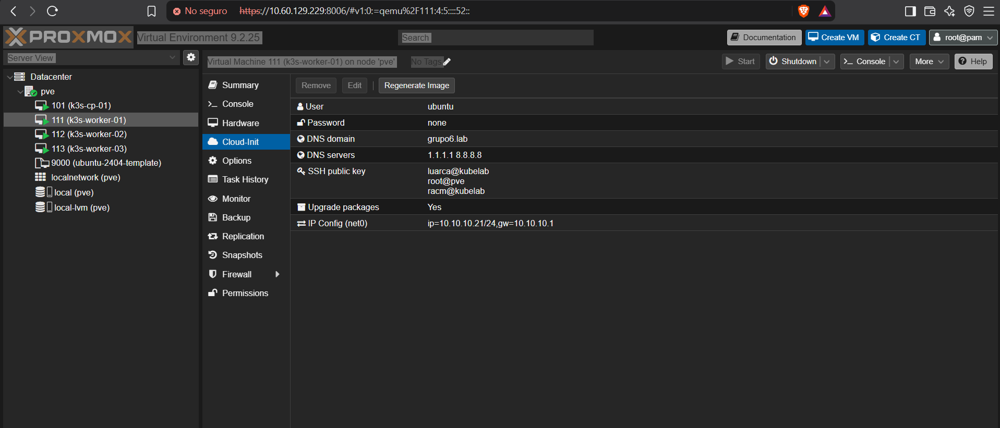 |
| Host network: routes, proxy ARP and NAT |  |
| Proxy ARP seen from a hotspot client | 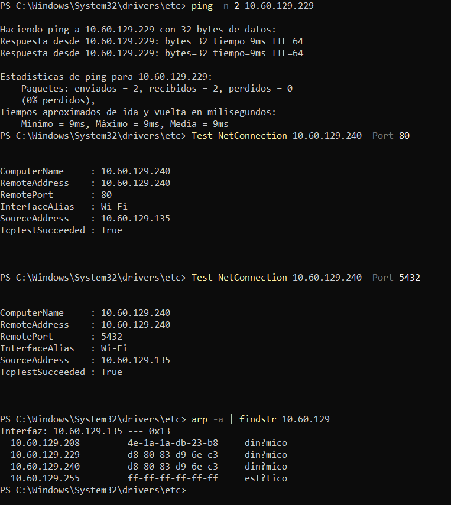 |
| k3s nodes |  |
| Team SSH and kubectl access |  |
| Traefik LoadBalancer and MetalLB pool |  |
| Argo CD Applications | 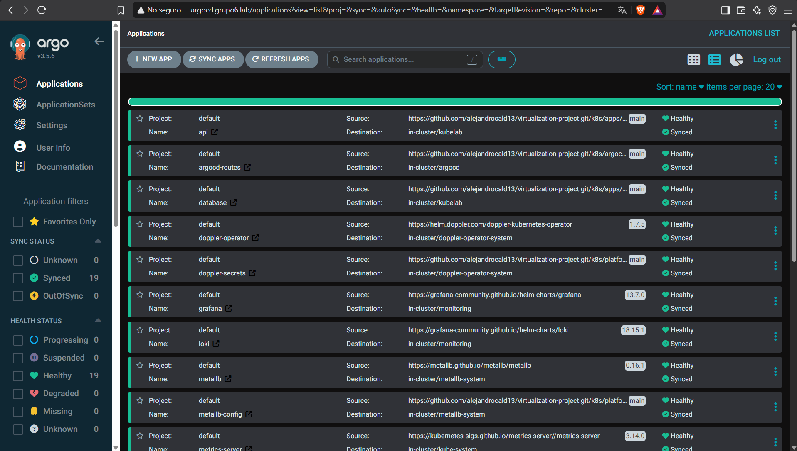 |
| DopplerSecrets and synced keys |  |
| GitHub Actions runs |  |
| Docker Hub images with commit tags | 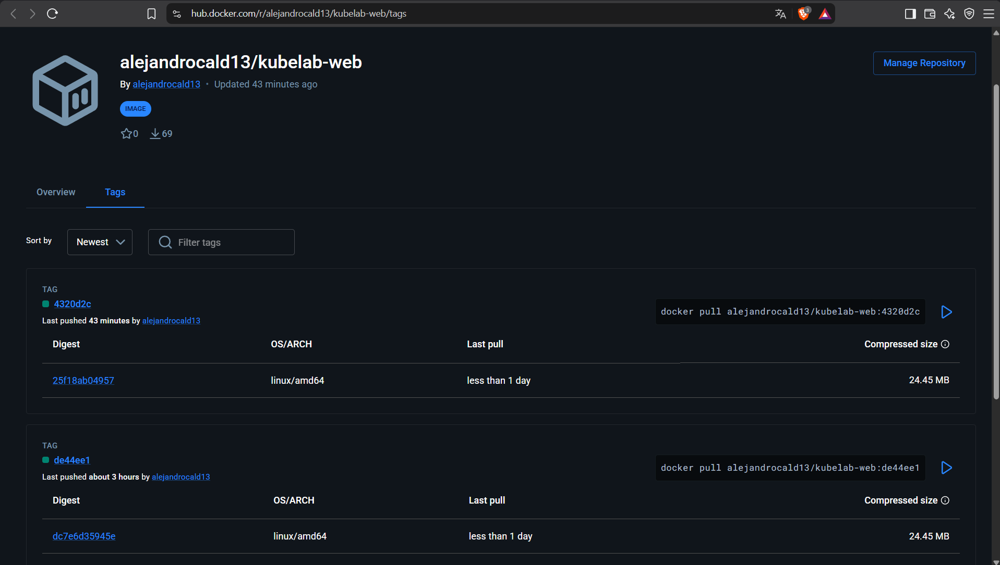 |
| `kubelab` resources |  |
| Web CRUD |  |
| API health |  |
| Read-only database access | 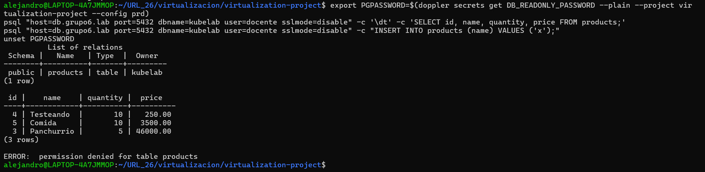 |
| Prometheus targets |  |
| Grafana data sources |  |
| KubeLab dashboard: CPU and memory by node and by pod | 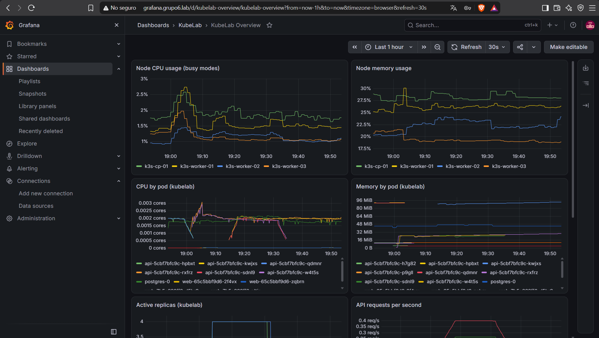 |
| KubeLab dashboard: replicas, API requests per second and logs | 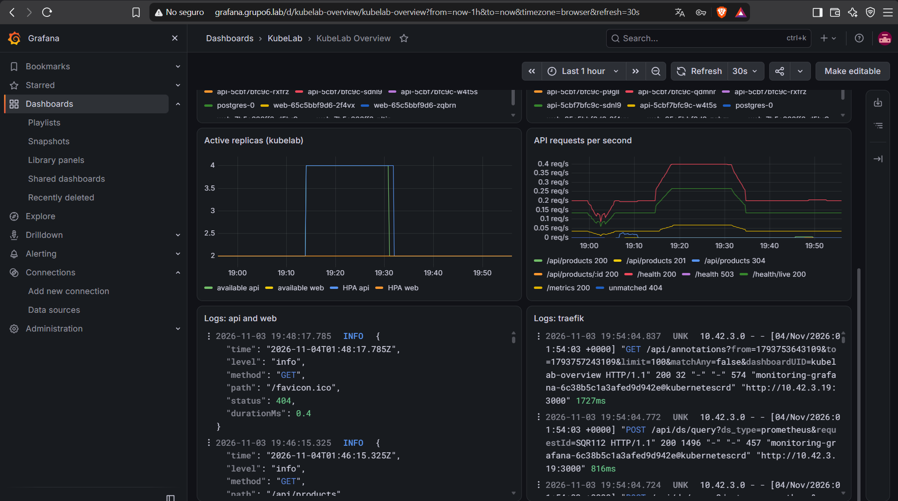 |
| Promtail on all nodes |  |
| PVCs on `nfs-client` |  |
| **Automatic scaling (HPA)**: k6 load and HPA from 2 to 4 replicas | 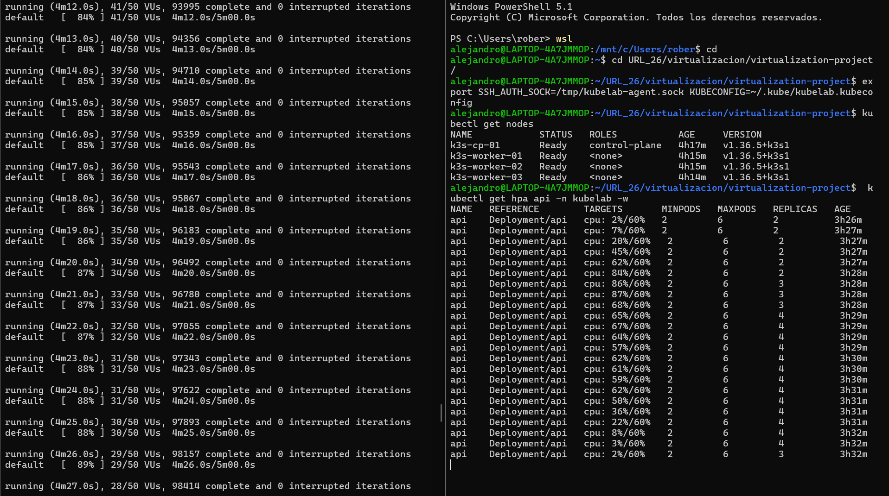 |
| **Automatic scaling (HPA)**: scaled API pods in Argo CD | 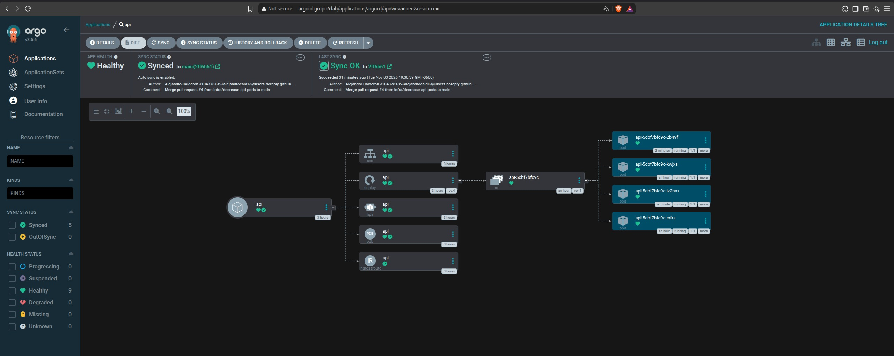 |
| Grafana during the load test |  |
| **Pod deletion without downtime** |  |
| Data persistence after deleting `postgres-0` | 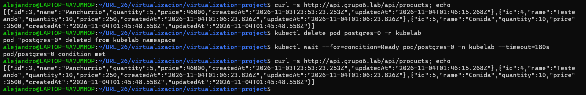 |
| Pull requests merged into `main` | 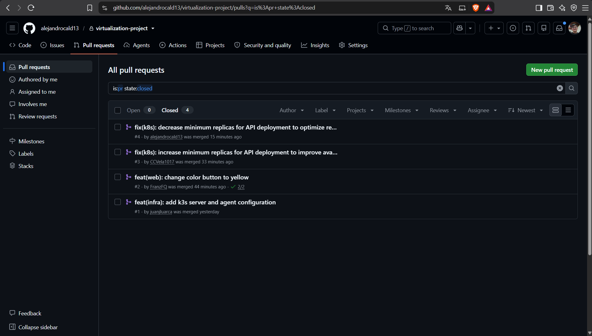 |
| **Automatic deployment (GitOps)**: pipeline | 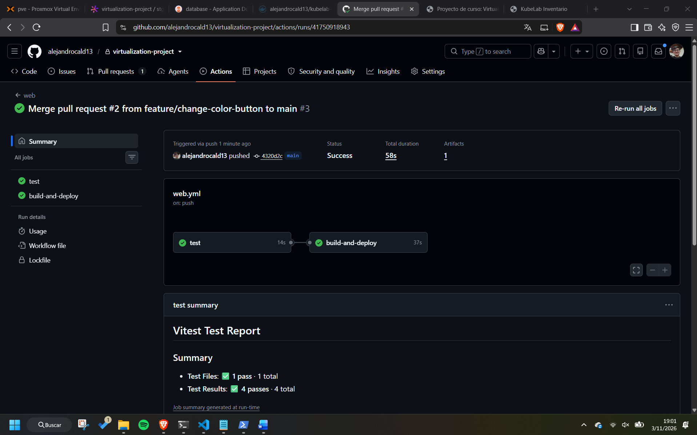 |
| **Automatic deployment (GitOps)**: new revision and image tag | 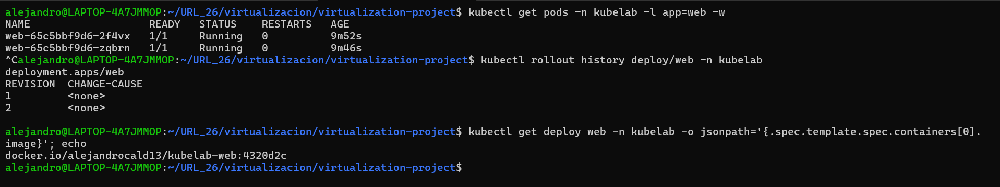 |
| **Automatic deployment (GitOps)**: change live, bot commit and Docker Hub push | 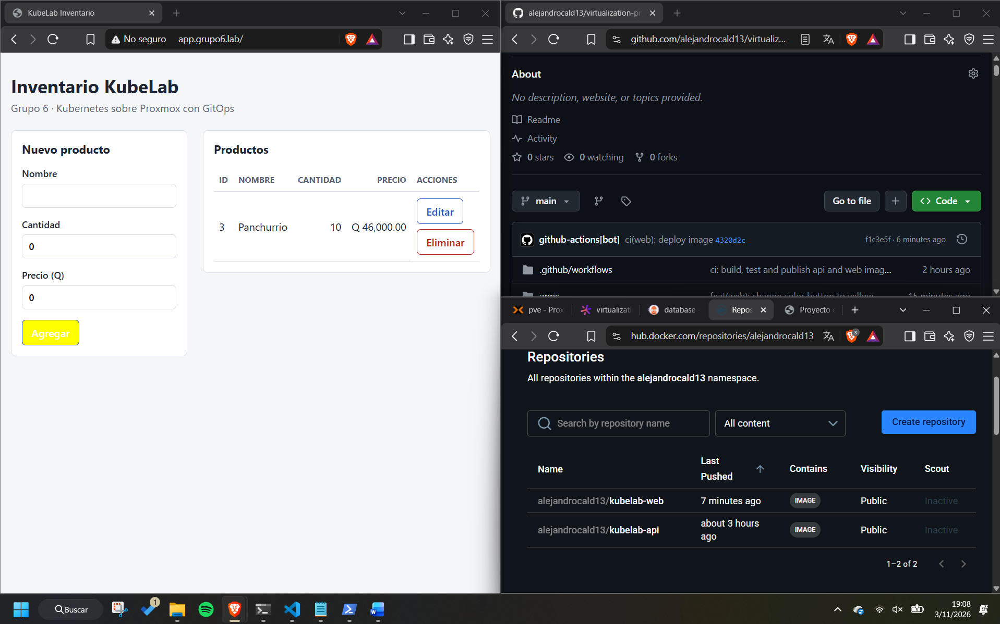 |
| Manifest-only change: Argo CD syncs the merged PR and scales the API | 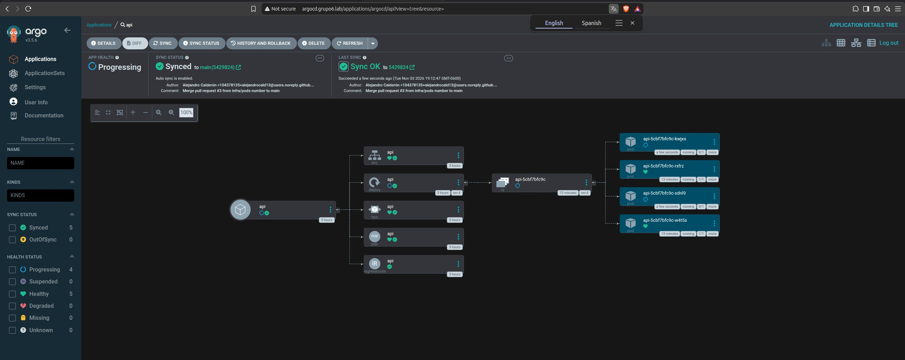 |
| Manifest-only change: HPA minimum applied, no image built |  |
| Manifest-only change: no workflow run |  |
| Argo CD selfHeal |  |
| Access test from an external laptop |  |
